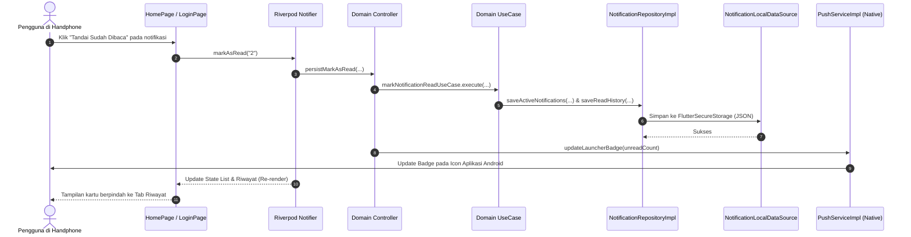
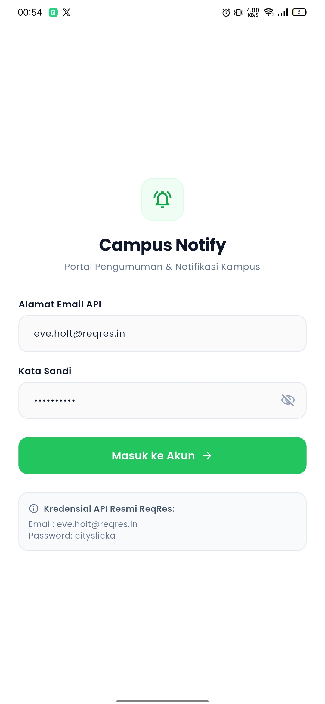
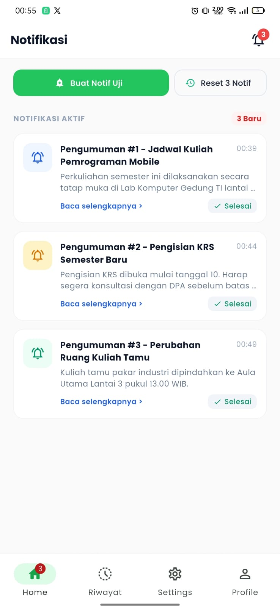
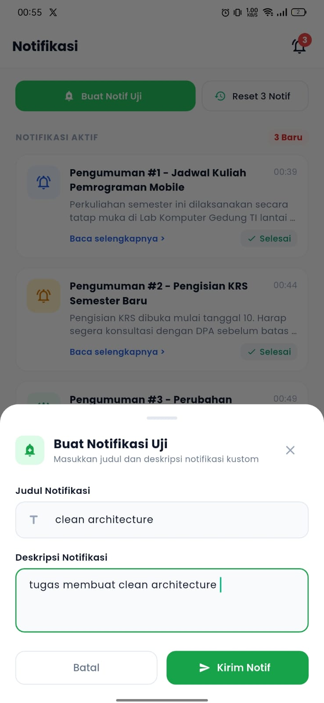
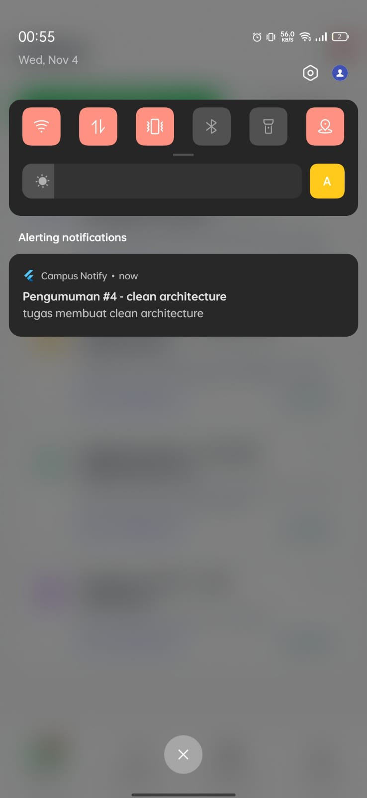
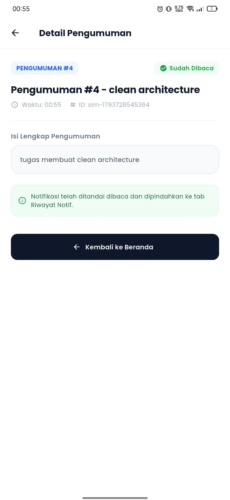
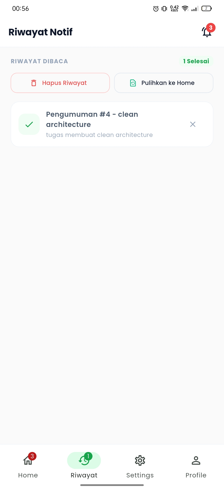
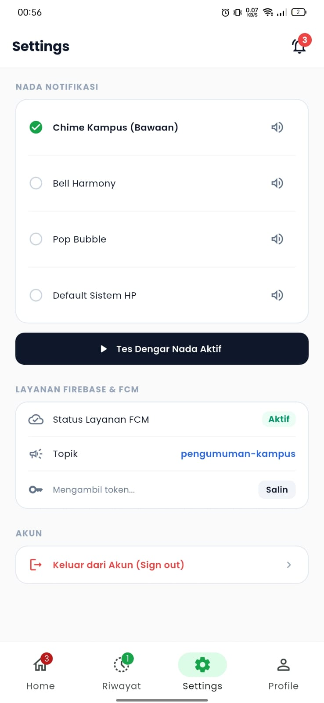
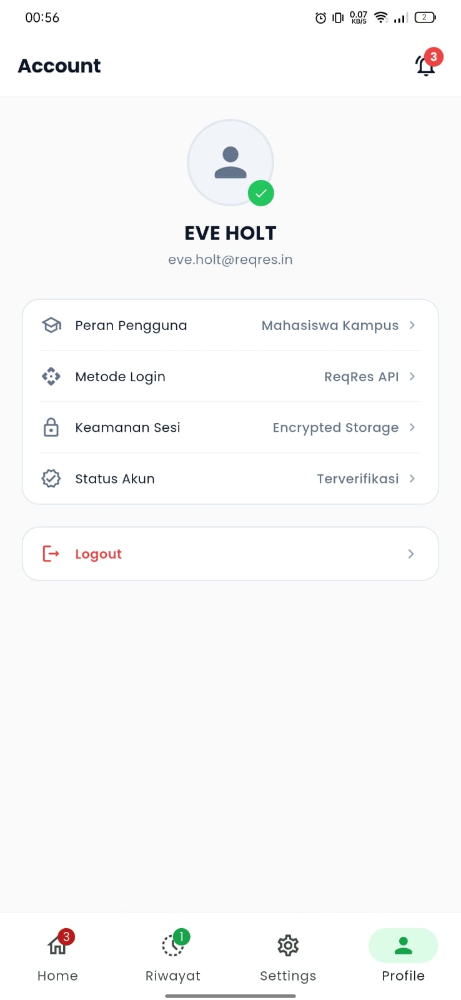

# Campus Notify SOLID 📱🏛️

> **Aplikasi Mobile Pengumuman Kampus & Notifikasi Cerdas**  
> Dibangun dengan **Flutter**, menerapkan prinsip **Clean Architecture (Uncle Bob)** dan **SOLID Design Principles**, serta dilengkapi integrasi **Firebase Cloud Messaging (FCM)**, **Custom Sound Notification**, dan **Native Android Launcher App Badge**.

---

## 📑 Daftar Isi
1. [Ringkasan Proyek](#-ringkasan-proyek)
2. [Apa yang Berubah: `campus_notify` vs `campus_notify_solid`](#-apa-yang-berubah-campus_notify-vs-campus_notify_solid)
   - [Latar Belakang Refactoring](#latar-belakang-refactoring)
   - [Tabel Perbandingan Komparatif](#tabel-perbandingan-komparatif)
   - [Peta Perubahan Struktur Berkas](#peta-perubahan-struktur-berkas)
3. [Implementasi Prinsip SOLID](#-implementasi-prinsip-solid)
4. [Bedah Clean Architecture (Letak & Peran Tiap Layer)](#-bedah-clean-architecture)
   - [Diagram Arsitektur](#diagram-arsitektur)
   - [1. Domain Layer (`lib/domain/`)](#1-domain-layer-libdomain)
   - [2. Data Layer (`lib/data/`)](#2-data-layer-libdata)
   - [3. Presentation Layer (`lib/presentation/`)](#3-presentation-layer-libpresentation)
   - [Alur Aliran Data (Data Flow Cycle)](#alur-aliran-data-data-flow-cycle)
5. [Fitur-Fitur Utama Aplikasi](#-fitur-fitur-utama-aplikasi)
6. [Galeri Screenshot Aplikasi di Handphone](#-galeri-screenshot-aplikasi-di-handphone)
   - [Tampilan Antarmuka Mobile](#tampilan-antarmuka-mobile)
   - [Daftar & Penjelasan Screenshot](#daftar--penjelasan-screenshot)
7. [Panduan Instalasi & Menjalankan Aplikasi](#-panduan-instalasi--menjalankan-aplikasi)
8. [Akun Pengujian (Testing Credentials)](#-akun-pengujian-testing-credentials)

---

## 📌 Ringkasan Proyek

`campus_notify_solid` adalah evolusi arsitektural dari proyek aplikasi `campus_notify`. Aplikasi ini berfungsi sebagai pusat informasi dan notifikasi bagi mahasiswa di lingkungan kampus. Mahasiswa dapat menerima pengumuman mendesak, melihat nomor urut notifikasi, mendengarkan nada dering khusus, mengelola riwayat notifikasi yang telah dibaca, serta melihat jumlah notifikasi yang belum dibaca langsung dari lencana (*badge*) ikon aplikasi di layar utama (*launcher homescreen*) handphone Android.

---

## 🔄 Apa yang Berubah: `campus_notify` vs `campus_notify_solid`

### Latar Belakang Refactoring
Pada versi awal (`campus_notify`), aplikasi dibangun dengan struktur **datar (flat/monolithic structure)** di mana logika presentasi, manipulasi *state*, pemanggilan API HTTP, serialisasi JSON, persistensi penyimpanan lokal, dan *platform channel* Android bercampur di dalam berkas yang sama. 

Kelemahan pada `campus_notify`:
- **Kopling Tinggi (*Tight Coupling*)**: Widget UI dan State Provider bergantung langsung pada pustaka pihak ketiga konkret (`Dio`, `FlutterSecureStorage`, `FirebaseMessaging`).
- **Pelanggaran Single Responsibility (SRP)**: Berkas seperti `notification_provider.dart` menangani definisi entitas, serialisasi JSON `fromJson`/`toJson`, penyimpanan `SharedPreferences`, pemanggilan native Android `MethodChannel`, serta pembaruan *state* UI sekaligus.
- **Sulit Diuji (*Hard to Test*)**: Logika bisnis tidak dapat diuji secara terisolasi tanpa melakukan *mocking* terhadap platform Flutter dan layanan eksternal.
- **Ketiadaan Abstraksi (*No Inversion of Control*)**: Modul tingkat tinggi bergantung langsung pada modul tingkat rendah.

Pada `campus_notify_solid`, seluruh kode direfaktor total ke **Clean Architecture** berbasis 3 lapisan (*Domain*, *Data*, *Presentation*) yang dipandu oleh **5 Prinsip Desain SOLID**.

---

### Tabel Perbandingan Komparatif

| Aspek Arsitektur | `campus_notify` (Versi Awal) | `campus_notify_solid` (Versi SOLID) |
| :--- | :--- | :--- |
| **Pola Arsitektur** | Flat / Feature-by-Type tanpa lapisan terpisah | **Clean Architecture** (Domain, Data, Presentation Layers) |
| **Penerapan SOLID** | Banyak terjadi pelanggaran SRP, OCP, dan DIP | Patuh penuh terhadap **S-O-L-I-S-D** |
| **Domain Layer** | ❌ Tidak ada (aturan bisnis bercampur di Provider/Data) | ✅ Ada (`lib/domain/`), 100% murni Dart tanpa dependensi UI |
| **Entitas Bisnis (Entities)** | Entitas bercampur dengan logika serialisasi JSON | Pure Business Entity (`CampusNotification`, `AuthSession`) tanpa JSON parser |
| **Model Data (DTO)** | Tidak dipisahkan dari entitas | `CampusNotificationModel` & `AuthSessionModel` memisahkan mapping JSON |
| **Kontrak Antarmuka (Interface)** | ❌ Langsung mengacu ke kelas konkret (`TokenStore`, `AuthRepository`) | ✅ Dipisahkan ke Abstract Repositories & Services di Domain Layer |
| **Use Cases** | ❌ Tidak ada; logika langsung dieksekusi di State Notifier | ✅ Setiap logika bisnis spesifik memiliki berkas Use Case terisolasi |
| **Orkestrasi Logika** | Notifier UI mengurus business rules & storage logic | Diorkestrasi oleh **Domain Controllers** (`AuthController`, `NotificationController`) |
| **Data Sources** | Bercampur di repository dan store | Terbagi rapi menjadi `datasources/local` dan `datasources/remote` |
| **Dependency Inversion** | Modul tinggi bergantung pada pustaka/store konkret | Modul tinggi bergantung pada abstraksi; diinjeksi via **Riverpod** |
| **Unit Testability** | Rentan gagal karena terikat plugin platform | Mudah diuji secara independen dengan mock interface |

---

### Peta Perubahan Struktur Berkas

```text
campus_notify (Sebelum)                     campus_notify_solid (Sesudah)
├── lib/                                    ├── lib/
│   ├── data/                               │   ├── domain/                         <-- [BARU: Core Business Logic]
│   │   ├── api_client.dart                 │   │   ├── entities/                   # Entitas Murni Dart
│   │   ├── api_errors.dart                 │   │   │   ├── auth_session.dart
│   │   ├── auth_repository.dart            │   │   │   ├── campus_notification.dart
│   │   └── token_store.dart                │   │   │   └── notification_sound_option.dart
│   ├── messaging/                          │   │   ├── repositories/               # Abstraksi Antarmuka (Contracts)
│   │   ├── push_service.dart               │   │   │   ├── auth_repository.dart
│   │   └── route_parser.dart               │   │   │   ├── notification_repository.dart
│   ├── pages/                              │   │   │   ├── notification_service.dart
│   │   ├── announcement_page.dart          │   │   │   └── token_repository.dart
│   │   ├── home_page.dart                  │   │   ├── usecases/                   # Single Action Business Rules
│   │   └── login_page.dart                 │   │   │   ├── auth/
│   ├── providers/                          │   │   │   │   ├── check_auth_status_usecase.dart
│   │   ├── auth_provider.dart              │   │   │   │   ├── get_user_email_usecase.dart
│   │   └── notification_provider.dart      │   │   │   │   ├── login_usecase.dart
│   ├── main.dart                           │   │   │   │   └── logout_usecase.dart
│   └── routes.dart                         │   │   │   └── notification/
│                                           │   │   │       ├── add_notification_usecase.dart
│                                           │   │   │       ├── get_notifications_usecase.dart
│                                           │   │   │       ├── manage_history_usecase.dart
│                                           │   │   │       ├── mark_notification_read_usecase.dart
│                                           │   │   │       ├── reset_notifications_usecase.dart
│                                           │   │   │       └── restore_history_usecase.dart
│                                           │   │   └── controllers/                # Domain Coordinators
│                                           │   │       ├── auth_controller.dart
│                                           │   │       └── notification_controller.dart
│                                           │   │
│                                           │   ├── data/                           <-- [DIREFAKTOR: Data & Infrastructure]
│                                           │   │   ├── datasources/
│                                           │   │   │   ├── local/                  # Local Storage (SecureStorage)
│                                           │   │   │   │   ├── notification_local_datasource.dart
│                                           │   │   │   │   └── token_local_datasource.dart
│                                           │   │   │   └── remote/                 # Remote API (Dio / Network)
│                                           │   │   │       ├── api_client.dart
│                                           │   │   │       └── auth_remote_datasource.dart
│                                           │   │   ├── models/                     # DTO & JSON Serialization
│                                           │   │   │   ├── auth_session_model.dart
│                                           │   │   │   └── campus_notification_model.dart
│                                           │   │   ├── repositories/               # Implementasi Nyata Repository
│                                           │   │   │   ├── auth_repository_impl.dart
│                                           │   │   │   ├── notification_repository_impl.dart
│                                           │   │   │   └── token_repository_impl.dart
│                                           │   │   ├── services/                   # Implementasi Push & Native
│                                           │   │   │   ├── push_service_impl.dart
│                                           │   │   │   └── route_parser.dart
│                                           │   │   └── api_errors.dart
│                                           │   │
│                                           │   ├── presentation/                   <-- [DIREFAKTOR: UI & State]
│                                           │   │   ├── pages/                      # Layar Tampilan (UI)
│                                           │   │   │   ├── announcement_page.dart
│                                           │   │   │   ├── home_page.dart
│                                           │   │   │   └── login_page.dart
│                                           │   │   ├── providers/                  # Riverpod State Notifiers & DI
│                                           │   │   │   ├── auth_provider.dart
│                                           │   │   │   └── notification_provider.dart
│                                           │   │   └── routes/                     # Definisi Jalur Navigasi
│                                           │   │       └── app_routes.dart
│                                           │   ├── main.dart
│                                           │   └── routes.dart
```

---

## 🛡️ Implementasi Prinsip SOLID

Penerapan kelima prinsip SOLID diwujudkan secara nyata dalam kode sumber:

### 1. Single Responsibility Principle (SRP)
> *"Sebuah kelas hanya boleh memiliki satu alasan untuk berubah."*

- **Sebelum**: `notification_provider.dart` bertanggung jawab atas representasi entitas notifikasi, mem-parse JSON `Map<String, dynamic>`, membaca dan menulis ke SharedPreferences, mengirim sinyal pembaruan badge via `MethodChannel`, dan mengatur *state* UI.
- **Sesudah**:
  - `CampusNotification` (`domain/entities/`): Hanya memegang data bisnis entitas notifikasi, immutable, dan perbandingan kesetaraan (`operator ==`).
  - `CampusNotificationModel` (`data/models/`): Hanya bertanggung jawab atas konversi data ke/dari JSON (`fromJson` & `toJson`).
  - `NotificationLocalDataSource` (`data/datasources/local/`): Hanya bertanggung jawab atas operasi I/O penyimpanan lokal.
  - `AddNotificationUseCase` (`domain/usecases/`): Hanya bertanggung jawab atas logika penambahan notifikasi baru.
  - `NotificationNotifier` (`presentation/providers/`): Hanya bertanggung jawab memegang *state* UI list notifikasi aktif.

### 2. Open/Closed Principle (OCP)
> *"Entitas perangkat lunak harus terbuka untuk ekstensi, tetapi tertutup untuk modifikasi."*

- Semua interaksi data dan layanan eksternal diabstraksikan melalui antarmuka abstrak (*abstract class*):
  - `NotificationRepository`
  - `AuthRepository`
  - `TokenRepository`
  - `NotificationService`
- Jika aplikasi ingin beralih dari penyimpanan lokal `FlutterSecureStorage` ke basis data `SQLite`/`Hive`, atau beralih dari Firebase Cloud Messaging ke penyedia push lain (misalnya OneSignal), kita **tidak perlu mengubah sebaris pun kode pada Domain Layer atau Presentation Layer**. Kita cukup membuat kelas implementasi baru yang mengadopsi kontrak antarmuka yang ada.

### 3. Liskov Substitution Principle (LSP)
> *"Objek dari superclass harus dapat digantikan dengan objek dari subclass tanpa merusak kebenaran program."*

- `CampusNotificationModel` mewarisi `CampusNotification` (`extends CampusNotification`). Seluruh komponen use case dan UI yang membutuhkan entitas `CampusNotification` dapat menerima instansi `CampusNotificationModel` tanpa memerlukan type-casting khusus ataupun menimbulkan efek samping tak terduga.
- Kelas implementasi seperti `NotificationRepositoryImpl` dan `AuthRepositoryImpl` memenuhi seluruh kontrak metode dari `NotificationRepository` dan `AuthRepository` tanpa melempar eksepsi *unimplemented* atau merusak ekspektasi tipe balik data.

### 4. Interface Segregation Principle (ISP)
> *"Klien tidak boleh dipaksa untuk bergantung pada antarmuka yang tidak mereka gunakan."*

- Daripada membuat satu antarmuka raksasa (misalnya `AppRepository`), antarmuka dipisahkan secara granular sesuai ranah fungsinya:
  - `AuthRepository`: Khusus operasi masuk (*login*) dan pembaharuan token (*refresh*).
  - `TokenRepository`: Khusus penyimpanan token akses, token refresh, dan identitas email sesi lokal.
  - `NotificationRepository`: Khusus menyimpan dan memuat daftar notifikasi aktif serta riwayat notifikasi yang telah dibaca.
  - `NotificationService`: Khusus operasi interaksi perangkat (menampilkan notifikasi lokal, memainkan pratinjau audio nada dering, dan memperbarui lencana pada ikon aplikasi).

### 5. Dependency Inversion Principle (DIP)
> *"Modul tingkat tinggi tidak boleh bergantung pada modul tingkat rendah. Keduanya harus bergantung pada abstraksi."*

- Modul logika bisnis tingkat tinggi (`UseCases`, `Controllers`, dan `Notifiers`) **tidak pernah mengimpor atau memanggil pustaka konkret** seperti `Dio`, `FlutterSecureStorage`, atau `FirebaseMessaging`.
- Lapisan domain hanya mengenali kontrak antarmuka abstrak.
- Konfigurasi dependensi nyata disuntikkan secara dinamis (*Dependency Injection*) pada berkas provider Riverpod:
  ```dart
  // Abstraksi di Domain Layer:
  abstract class NotificationRepository { ... }

  // Implementasi di Data Layer:
  class NotificationRepositoryImpl implements NotificationRepository { ... }

  // Dependency Inversion Wiring di Provider (Riverpod):
  final notificationRepositoryProvider = Provider<NotificationRepository>((ref) {
    return NotificationRepositoryImpl(
      localDataSource: ref.watch(notificationLocalDataSourceProvider),
    );
  });
  ```

---

## 🏛️ Bedah Clean Architecture

### Diagram Arsitektur

```text
┌────────────────────────────────────────────────────────────────────────┐
│                          PRESENTATION LAYER                            │
│  - Pages: LoginPage, HomePage, AnnouncementPage                        │
│  - Riverpod Providers: authStateProvider, notificationListProvider     │
│  - Routes: AppRoutes (GoRouter)                                        │
└───────────────────────────────────┬────────────────────────────────────┘
                                    │ (Depends on)
                                    ▼
┌────────────────────────────────────────────────────────────────────────┐
│                             DOMAIN LAYER                               │
│       * Core Business Logic & Enterprise Rules (Pure Dart) *           │
│                                                                        │
│  ┌───────────────────────┐             ┌────────────────────────────┐  │
│  │       Entities        │             │          Use Cases         │  │
│  │  - CampusNotification │             │  - LoginUseCase            │  │
│  │  - AuthSession        │             │  - AddNotificationUseCase  │  │
│  │  - SoundOption        │             │  - MarkAsReadUseCase, etc. │  │
│  └───────────────────────┘             └─────────────┬──────────────┘  │
│                                                      │                 │
│  ┌───────────────────────────────────────────────────▼──────────────┐  │
│  │                   Repositories (Contracts)                       │  │
│  │  - AuthRepository            - NotificationRepository            │  │
│  │  - TokenRepository           - NotificationService               │  │
│  └───────────────────────────────────▲──────────────────────────────┘  │
└──────────────────────────────────────│─────────────────────────────────┘
                                       │ (Implements / Inverted)
┌──────────────────────────────────────┴─────────────────────────────────┐
│                             DATA LAYER                                 │
│  - Models (DTO): CampusNotificationModel, AuthSessionModel             │
│  - Data Sources: TokenLocalDataSource, NotificationLocalDataSource     │
│  - Remote Data Sources: AuthRemoteDataSource, ApiClient (Dio)          │
│  - Repositories Impl: AuthRepositoryImpl, NotificationRepositoryImpl   │
│  - External Services: PushService (FCM, Local Notif, Audio, Badge)     │
└────────────────────────────────────────────────────────────────────────┘
```

---

### 1. Domain Layer (`lib/domain/`)
Lapisan terdalam dan paling independen. **Tidak boleh mengimpor Flutter UI (`material.dart`) atau pustaka infrastruktur eksternal.**

1. **Entities (`lib/domain/entities/`)**:
   - `campus_notification.dart`: Entitas inti notifikasi kampus (id, number urut, judul, isi, timestamp, announcementId, isRead). Dilengkapi metode `copyWith` serta perbandingan kesetaraan nilai (`==` dan `hashCode`).
   - `auth_session.dart`: Entitas sesi pengguna (token akses, token refresh, email, nama).
   - `notification_sound_option.dart`: Enumerasi opsi nada dering (`defaultSound`, `bell`, `pop`).
2. **Repositories (`lib/domain/repositories/`)**:
   - `notification_repository.dart`: Kontrak pengambilan dan penyimpanan notifikasi aktif serta riwayat.
   - `auth_repository.dart`: Kontrak autentikasi login ke API.
   - `token_repository.dart`: Kontrak penyimpanan token dan email akun.
   - `notification_service.dart`: Kontrak pemutaran audio, penampilan banner notifikasi, dan pengaturan lencana aplikasi.
3. **Use Cases (`lib/domain/usecases/`)**:
   - **Auth**:
     - `login_usecase.dart`: Memvalidasi input (email & kata sandi wajib diisi, kata sandi minimal 6 karakter, validasi akun resmi ReqRes `eve.holt@reqres.in`), lalu mengeksekusi login dan menyimpan token ke repositori.
     - `logout_usecase.dart`: Membersihkan sesi dan membatalkan langganan topik FCM.
     - `check_auth_status_usecase.dart`: Memeriksa ketersediaan token aktif.
     - `get_user_email_usecase.dart`: Mengambil email pengguna yang sedang login.
   - **Notification**:
     - `get_notifications_usecase.dart`: Mengambil daftar notifikasi aktif awal.
     - `add_notification_usecase.dart`: Menyisipkan notifikasi baru ke daftar teratas.
     - `mark_notification_read_usecase.dart`: Memindahkan notifikasi dari daftar aktif ke daftar riwayat dibaca.
     - `reset_notifications_usecase.dart`: Mengembalikan daftar notifikasi ke 3 item bawaan default.
     - `restore_history_usecase.dart`: Mengembalikan notifikasi yang sudah dibaca kembali ke daftar belum dibaca.
     - `manage_history_usecase.dart`: Memuat dan membersihkan seluruh riwayat notifikasi.
4. **Controllers (`lib/domain/controllers/`)**:
   - `auth_controller.dart` & `notification_controller.dart`: Berperan sebagai koordinator domain yang memadukan use case dan service agar presentation layer tetap bersih dari logika prosedural yang rumit.

---

### 2. Data Layer (`lib/data/`)
Lapisan yang menghubungkan aplikasi dengan dunia luar (jaringan internet, basis data, storage lokal, dan sistem operasi Android).

1. **Models (`lib/data/models/`)**:
   - `campus_notification_model.dart`: Turunan dari `CampusNotification` yang mengimplementasikan konversi JSON:
     - `factory CampusNotificationModel.fromJson(Map<String, dynamic> json)`
     - `Map<String, dynamic> toJson()`
     - `factory CampusNotificationModel.fromEntity(CampusNotification entity)`
   - `auth_session_model.dart`: Model representasi respons login API.
2. **Data Sources (`lib/data/datasources/`)**:
   - `local/token_local_datasource.dart`: Menyimpan dan membaca token ke media aman perangkat menggunakan `FlutterSecureStorage`.
   - `local/notification_local_datasource.dart`: Menyimpan daftar notifikasi aktif dan riwayat notifikasi ke `FlutterSecureStorage` dalam format serialisasi JSON.
   - `remote/auth_remote_datasource.dart`: Menghubungi endpoint API ReqRes (`https://reqres.in/api/login`) menggunakan pustaka `Dio`.
   - `remote/api_client.dart`: Konfigurasi dasar HTTP Client (Base URL, Timeouts, Interceptor).
3. **Repository Implementations (`lib/data/repositories/`)**:
   - `auth_repository_impl.dart`: Mengimplementasikan `AuthRepository` dari Domain Layer, meneruskan proses ke `AuthRemoteDataSource`.
   - `token_repository_impl.dart`: Mengimplementasikan `TokenRepository`, meneruskan proses ke `TokenLocalDataSource`.
   - `notification_repository_impl.dart`: Mengimplementasikan `NotificationRepository`, membaca data dari `NotificationLocalDataSource` dan memetakan model ke entitas domain.
4. **Services (`lib/data/services/`)**:
   - `push_service_impl.dart`: Mengimplementasikan `NotificationService`. Mengintegrasikan:
     - **Firebase Cloud Messaging (FCM)** untuk penerimaan pesan saat aplikasi di latar depan (*foreground*), latar belakang (*background*), maupun kondisi mati (*terminated*).
     - **Flutter Local Notifications Plugin** untuk memunculkan heads-up banner di Android.
     - **AudioPlayer** untuk memutar nada dering kustom (`notification_sound.wav`, `sound_bell.wav`, `sound_pop.wav`).
     - **MethodChannel** (`com.example.campus_notify/badge`) untuk memperbarui angka lencana langsung pada ikon aplikasi di homescreen handphone Android.
   - `route_parser.dart`: Mengurai muatan (*payload*) notifikasi untuk navigasi mendalam (*deep linking*).

---

### 3. Presentation Layer (`lib/presentation/`)
Lapisan tampilan pengguna (*User Interface*) dan manajemen status (*State Management*).

1. **Providers (`lib/presentation/providers/`)**:
   - `auth_provider.dart`: Menginisialisasi *Dependency Injection graph* untuk modul autentikasi dan mengekspos `authStateProvider` serta `userEmailProvider`.
   - `notification_provider.dart`: Menginjeksi data source, repository, use case, dan controller, serta menyediakan:
     - `notificationListProvider`: StateNotifier penyedia daftar notifikasi aktif.
     - `readHistoryProvider`: StateNotifier penyedia daftar riwayat notifikasi yang sudah dibaca.
     - `unreadNotificationCountProvider`: Provider penghitung jumlah notifikasi belum dibaca.
     - `fcmTokenProvider`: Provider token FCM perangkat.
2. **Pages (`lib/presentation/pages/`)**:
   - `login_page.dart`: Halaman masuk dengan form validasi interaktif dan tombol aksi API Login.
   - `home_page.dart`: Layar utama dengan navigasi bilah bawah (*bottom navigation bar*) berisi 4 tab:
     1. **Home**: Daftar notifikasi aktif berurutan (nomor 1, 2, 3), lencana jumlah belum dibaca, tombol "Buat Notif Uji", tombol salin token FCM, dan tombol reset.
     2. **Riwayat**: Daftar notifikasi yang telah dibaca dengan opsi pemulihan (*restore*) kembali ke beranda atau pembersihan total.
     3. **Settings**: Pemilihan nada notifikasi kampus dengan tombol uji dengar langsung (*preview sound*).
     4. **Profile**: Informasi akun mahasiswa yang sedang login beserta tombol keluar (*logout*).
   - `announcement_page.dart`: Layar detail pengumuman lengkap ketika kartu notifikasi atau push notification diklik.
3. **Routes (`lib/presentation/routes/` & `lib/routes.dart`)**:
   - Konfigurasi `GoRouter` dengan sistem pengalihan rute dinamis (*route redirection*) berbasis status autentikasi aktif.

---

### Alur Aliran Data (Data Flow Cycle)



---

## ✨ Fitur-Fitur Utama Aplikasi

1. 🔐 **Autentikasi Terintegrasi API & Sesi Aman**:
   - Login terhubung ke endpoint publik **ReqRes API**.
   - Validasi kredensial ketat (email dan kata sandi divalidasi di `LoginUseCase`).
   - Penyimpanan token akses & token refresh menggunakan **FlutterSecureStorage** terenkripsi.
2. 🔔 **Push Notification & Heads-Up Banner Real-Time**:
   - Menerima push notification dari **Firebase Cloud Messaging (FCM)**.
   - Penampilan notifikasi melayang (*heads-up banner*) di notification tray Android.
   - Navigasi otomatis ke halaman detail pengumuman saat notifikasi diklik (*Deep Linking*).
3. 🎵 **Pemilihan & Pratinjau Nada Dering Kustom (Custom Sounds)**:
   - Tiga variasi nada dering yang tersimpan di aset lokal dan `res/raw` Android:
     - **Default Sound** (`notification_sound.wav`)
     - **Bell Sound** (`sound_bell.wav`)
     - **Pop Sound** (`sound_pop.wav`)
   - Fitur uji dengar suara langsung pada tab Pengaturan.
4. 🔢 **Penomoran Urut & Badge Counter Otomatis**:
   - Notifikasi memiliki nomor urut otomatis (1, 2, 3...) yang terus bertambah.
   - Jumlah notifikasi aktif belum dibaca disinkronkan ke badge di dalam aplikasi.
5. 🏷️ **Native Launcher App Badge Android (MethodChannel)**:
   - Sinkronisasi jumlah notifikasi belum dibaca langsung ke ikon aplikasi di layar utama (*launcher*) handphone.
   - Mendukung berbagai antarmuka Android vendor ternama:
     - **Xiaomi / Redmi / POCO** (MIUI / HyperOS)
     - **Samsung** (One UI)
     - **Huawei / Honor**
     - **Oppo / Realme / Vivo**
6. 🧪 **Bottom Sheet Dialog "Buat Notif Uji"**:
   - Memudahkan pengujian langsung di handphone tanpa perlu mengirim pesan dari Firebase Console.
   - Pengguna dapat mengetikkan judul, deskripsi, dan memilih nada suara yang ingin dibunyikan.
7. 📜 **Manajemen Riwayat & Pemulihan (Read History & Restore)**:
   - Notifikasi yang dibaca berpindah secara otomatis ke tab Riwayat.
   - Tersedia tombol untuk memulihkan (*restore*) notifikasi kembali ke daftar belum dibaca.
8. 📋 **Salin Token FCM Sekali Klik**:
   - Tombol salin token perangkat untuk kemudahan pengujian pengiriman pesan dari backend/FCM console.

---

## 📱 Galeri Screenshot Aplikasi di Handphone

Bagian ini menampilkan hasil tangkapan layar (*screenshots*) aplikasi `campus_notify_solid` saat dijalankan langsung di perangkat handphone Android:

### Tampilan Antarmuka Mobile

| 1. Halaman Login | 2. Beranda (Notifikasi Aktif) | 3. Dialog Buat Notif Uji |
| :---: | :---: | :---: |
|  |  |  |
| *Form autentikasi ReqRes API* | *Daftar notifikasi & badge unread* | *Bottom sheet kustomisasi notif* |

| 4. Heads-Up Notification | 5. Launcher App Icon Badge | 6. Detail Pengumuman |
| :---: | :---: | :---: |
|  |  |  |
| *Banner notifikasi melayang di HP* | *Lencana angka di homescreen Android* | *Detail isi pengumuman kampus* |

| 7. Riwayat Notifikasi Dibaca | 8. Pengaturan Nada Notifikasi | 9. Profil Pengguna & Logout |
| :---: | :---: | :---: |
|  |  |  |
| *Daftar arsip & tombol restore* | *Uji nada dering: Default/Bell/Pop* | *Info akun & konfirmasi keluar* |

---

### Daftar & Penjelasan Screenshot

| No | Berkas Gambar | Halaman / Komponen | Keterangan Fungsional |
| :-: | :--- | :--- | :--- |
| **01** | `screenshots/login-page.jpeg` | **Login Page** | Tampilan antarmuka login bersih dengan input email, password (minimal 6 karakter), serta tombol aksi login yang terhubung ke API ReqRes. |
| **02** | `screenshots/home-page.jpeg` | **Home Page (Active List)** | Menampilkan daftar notifikasi aktif yang belum dibaca dengan nomor urut (1, 2, 3), waktu pengiriman, tombol tandai telah dibaca, serta tombol salin Token FCM. |
| **03** | `screenshots/add-new-notif.jpeg` | **Create Notification Modal** | Bottom sheet dialog melayang untuk membuat notifikasi uji secara langsung dengan judul, isi pesan, dan opsi pemilihan nada dering kustom. |
| **04** | `screenshots/pop-up-notif.jpeg` | **Heads-up Notification Banner** | Tampilan banner notifikasi melayang di notification tray Android disertai suara nada dering kustom yang dipilih saat notifikasi masuk. |
| **05** | `screenshots/application-badge.jpeg` | **Launcher App Icon Badge** | Bukti sinkronisasi native lencana (*badge count*) pada ikon aplikasi di layar utama (*homescreen*) handphone Android yang sesuai dengan jumlah pesan belum dibaca. |
| **06** | `screenshots/detail-notif-page.jpeg` | **Announcement Detail Page** | Tampilan layar detail informasi pengumuman ketika kartu notifikasi atau notifikasi push diklik oleh pengguna. |
| **07** | `screenshots/history-notif-page.jpeg` | **Read History Tab** | Menampilkan daftar riwayat notifikasi yang telah dibaca, dilengkapi aksi untuk mengembalikan (*restore*) notifikasi ke beranda atau menghapus seluruh riwayat. |
| **08** | `screenshots/settings-page.jpeg` | **Settings Tab** | Menu preferensi pemilihan nada dering notifikasi kampus (**Default**, **Bell**, **Pop**) yang dilengkapi tombol uji dengar instan (*play preview sound*). |
| **09** | `screenshots/profile-page.jpeg` | **Profile & Logout Tab** | Informasi data akun mahasiswa yang sedang aktif dan dialog konfirmasi keluar dari sistem (*logout*) yang menghapus sesi token secara aman. |

---

## 🚀 Panduan Instalasi & Menjalankan Aplikasi

### 1. Prasyarat Sistem
- **Flutter SDK**: Versi `^3.13.4` atau lebih baru
- **Dart SDK**: Sesuai dengan distribusi Flutter
- **Android Studio / VS Code**: Dengan ekstensi Flutter & Dart
- Perangkat fisik Android (disarankan) atau Emulator Android dengan Google Play Services (untuk fitur FCM dan Launcher Badge)

### 2. Langkah Menjalankan Proyek

```bash
# 1. Buka direktori proyek
cd campus_notify_solid

# 2. Unduh seluruh dependensi Flutter
flutter pub get

# 3. Jalankan automated unit tests untuk verifikasi arsitektur
flutter test

# 4. Jalankan aplikasi pada perangkat handphone yang terhubung
flutter run
```

---

## 🔑 Akun Pengujian (Testing Credentials)

Aplikasi terhubung ke autentikasi resmi **ReqRes API**. Gunakan kredensial berikut untuk masuk ke aplikasi:

- **Email**: `eve.holt@reqres.in`
- **Kata Sandi**: `cityslicka`

> 💡 *Catatan: Sistem pada `LoginUseCase` memiliki validasi ketat. Menggunakan email atau kata sandi yang salah akan memunculkan dialog kesalahan yang informatif.*

---

## 👨‍💻 Kontributor
- **Pengembang**: Fijriati Rahmatur Rizqi
- **Proyek**: Campus Notify SOLID Architecture Refactoring
